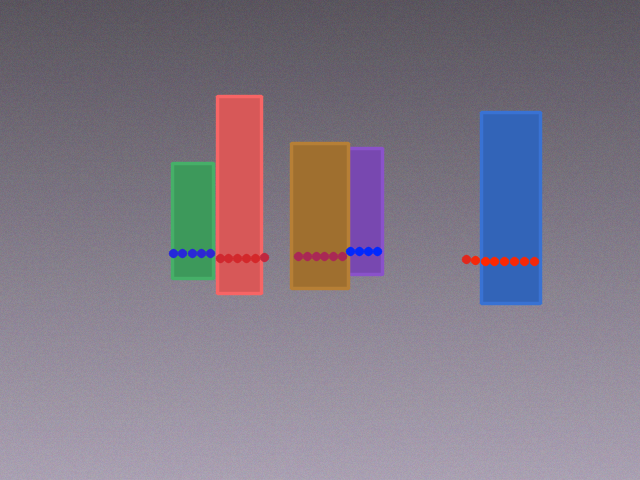
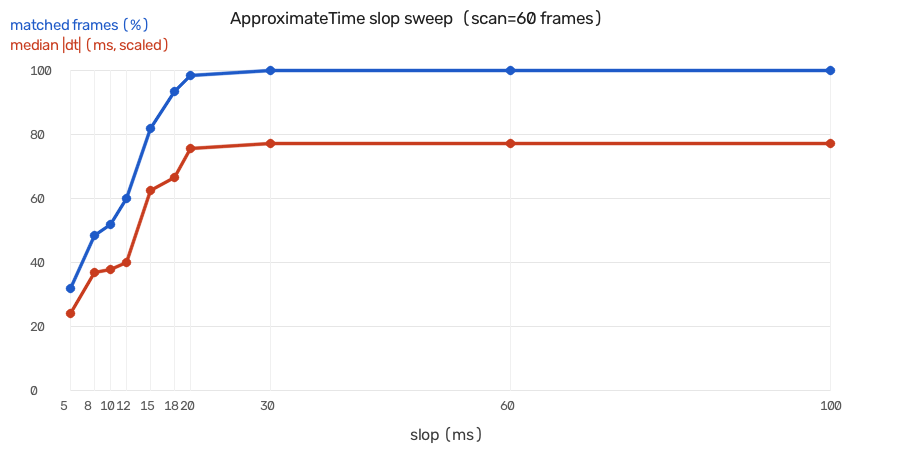

# M1-3 时间与坐标：把激光点投影到相机图像

一辆车上装了**摄像头**和**2D 激光雷达**：安装位置不同、采样频率不同（27 Hz vs 10 Hz）、
时间戳不同源。本模块要做的就是——建立 TF 树、把两路数据按时间对齐、再把激光点投影到
图像上，让两个传感器"看到同一个世界"。



## 目录结构

```text
M1-3/
├── make_bag.py                 # 合成数据生成器（生成 sample_bag + extrinsics.yaml）
├── extrinsics.yaml             # 默认外参/内参真值（唯一真值来源，代码里不许写死）
├── projection_1..3.png         # 三个不同时刻的投影效果图（近红远蓝）
├── slop_sweep.csv / .png       # slop 扫描实验数据与图
├── README.md
└── src/m1_projection/          # ament_python 包
    ├── package.xml  setup.py  setup.cfg  resource/m1_projection
    └── m1_projection/
        ├── projection_node.py  # 静态 TF + 近似时间同步 + 投影 + 出图
        └── slop_sweep.py       # 离线统计不同 slop 的配对数与时间差
```

## 环境

Ubuntu 22.04 + ROS 2 Humble；`python3-opencv`、`python3-numpy`、`python3-yaml`、`rosbag2_py`。

## 1. 生成数据

```bash
python3 make_bag.py                       # 200 帧雷达（≈20 s，约 500 MB，注意磁盘）
python3 make_bag.py --frames 60 --seed 7  # 短场景（≈143 MB），调试用
# 换一组安装位置与内参（现场验收就是这么干的）：
python3 make_bag.py --frames 20 --laser-z 0.45 --camera-z 0.75 --fx 420 \
    --out sample_bag_nd --extrinsics extrinsics_nd.yaml
```

生成 `sample_bag/`（`/scan`、`/camera/image_raw`、`/camera/camera_info`）和 `extrinsics.yaml`。
`--laser-x/--laser-z/--camera-x/--camera-z/--fx/--fy/--cx/--cy` 都可改，**`extrinsics.yaml`
是唯一真值来源**，节点只读它，不在代码里写死任何数值。

## 2. 编译与运行

```bash
cd M1-3
colcon build --symlink-install
source install/setup.bash

# 终端 1：回放（--clock 才会发布 /clock）
ros2 bag play sample_bag --clock

# 终端 2：投影节点（回放 bag 必须 use_sim_time:=true）
ros2 run m1_projection projection_node --ros-args -p use_sim_time:=true
```

参数（全部有默认值）：

| 参数 | 默认 | 说明 |
|---|---|---|
| `use_sim_time` | false | bag 回放必须 true |
| `extrinsics_file` | `extrinsics.yaml` | 外参/内参真值 |
| `output_dir` | `.` | 效果图输出目录 |
| `max_images` | 3 | 最多存几张 |
| `sync_slop` | 0.06 | ApproximateTime 的 slop（秒） |
| `queue_size` | 50 | 同步队列长度 |

输出：`/projection/debug_image`（`sensor_msgs/Image`，rgb8）+ `projection_N.png`。

## 3. TF 树

节点启动时从 `extrinsics.yaml` 读数值，用 `StaticTransformBroadcaster` 一次性发布：

```
map ──► odom ──► base_link ──► laser_link    (xyz 来自 yaml)
                     └────────► camera_link   (xyz + rpy 来自 yaml)
```

验证：

```bash
ros2 run tf2_tools view_frames          # 生成 frames.pdf，看树结构
ros2 run tf2_ros tf2_echo base_link camera_link
ros2 run tf2_ros tf2_echo base_link laser_link
```

实测（默认外参）：

```
base_link -> camera_link: Translation [0.100, 0.000, 0.300]
base_link -> laser_link : Translation [0.150, 0.000, 0.200]
```

## 4. 投影原理

激光点在 `laser_link` 下（2D，z=0），先转到 `base_link`，再转到相机机体坐标，最后转到
光学坐标系（z 向前、x 向右、y 向下）后做针孔投影：

```
P_base = R_laser · P_laser + t_laser
P_cam  = R_cam^T · (P_base - t_cam)
P_opt  = R_body→opt · P_cam         # [[0,-1,0],[0,0,-1],[1,0,0]]
u = fx · X_opt / Z_opt + cx
v = fy · Y_opt / Z_opt + cy
```

`R_body→opt` 是机体系（x 前 y 左 z 上）到光学系（x 右 y 下 z 前）的固定旋转。相机装在
激光平面之上，所以激光点会出现在图像**中心偏下**（本数据约 v≈260~300），这正是验收时
"投影点落在合理区域"的判据。

颜色按距离线性映射：**近红、远蓝**（用本帧内最近/最远距离归一化）。

## 5. 时间同步（核心取舍）

两路时间戳不会相等：雷达 10 Hz、相机 27 Hz，各自带抖动且相位不同。所以只能用
`ApproximateTimeSynchronizer`，`queue_size=50`（相机比雷达快 2.7 倍，队列小了早期帧会被挤掉）。

`slop` 扫描实验（60 帧雷达 / 162 帧相机，`slop_sweep.csv`）：

| slop | 配对帧数 | 配对率 | 中位 \|dt\| | 最大 \|dt\| |
|---|---|---|---|---|
| 5 ms | 19/60 | 32% | 2.74 ms | 4.63 ms |
| 8 ms | 29/60 | 48% | 4.23 ms | 7.75 ms |
| 10 ms | 31/60 | 52% | 4.33 ms | 9.03 ms |
| 12 ms | 36/60 | 60% | 4.60 ms | 11.71 ms |
| 15 ms | 49/60 | 82% | 7.19 ms | 14.33 ms |
| 18 ms | 56/60 | 93% | 7.66 ms | 17.33 ms |
| 20 ms | 59/60 | 98% | 8.69 ms | 19.62 ms |
| 30 ms | 60/60 | 100% | 8.86 ms | 20.77 ms |
| 60 ms | 60/60 | 100% | 8.86 ms | 20.77 ms |
| 100 ms | 60/60 | 100% | 8.86 ms | 20.77 ms |



结论：

- slop < 10 ms 时只能配上三到五成，**大量雷达帧被丢掉**；
- slop 增大后配对数单调上升，到 **30 ms 饱和（100%）**——因为相机 27 Hz，最近帧的时间差
  理论上限就是半个周期 ≈ 18.5 ms，实测最大 20.8 ms（含抖动）；
- 再往上（100 ms）配对数不再增加，但**风险变大**：一旦相机掉帧，就会接受"差一整个雷达
  周期"的帧，时间对齐质量下降。

因此默认取 **`sync_slop = 0.06`（60 ms）**：约为最大时间差的 3 倍，能容忍少量相机丢帧，
又远小于一个雷达周期（100 ms）。

⚠️ 注意 ApproximateTime 是**一对一贪心匹配**，不是"每个雷达帧各找最近的相机帧"：相机帧
多出来 2.7 倍，多余的直接丢弃。所以实际配对时间差（中位 8.9 ms）**大于**"理论最近距离"，
别把两者混为一谈。

## 6. use_sim_time 对比（实测日志）

| 场景 | 启动命令 | 节点日志 | 结果 |
|---|---|---|---|
| 正确 | `-p use_sim_time:=true` + `bag play --clock` | `node_clock=2.794, scan_stamp=2.803, 差值=0.009s` | 时钟与数据同一时间基准，出图正常 |
| 错误 | `-p use_sim_time:=false` + `bag play --clock` | `node_clock=1795058736.861, scan_stamp=0.997, 差值=1795058735.863s` + `[WARN] 时间基准不一致！` | 节点用墙钟、数据用仿真时间，差 17 亿秒 |

要点：`ros2 bag play --clock` 才会发布 `/clock`；节点 `use_sim_time:=true` 后 `now()` 才跟随
bag 时间。**本题的静态 TF 与时间无关**，所以即使配错，投影仍能出图——这正是最容易被忽略
的坑：一旦换成动态 TF（如 `odom→base_link` 随车运动）或任何依赖 `now()` 的逻辑（超时判断、
rviz 时间轴），时间基准错了就会直接失败/看不到数据。

演示方法（录屏用）：同一个命令分别加 `-p use_sim_time:=true` 与 `:=false` 跑一遍，对比上面
两行日志。

## 7. 验收对应

```bash
# 1) 换一组非默认外参，现场重生成 bag 再跑（本实现只读 yaml，不写死）
python3 make_bag.py --laser-z 0.45 --camera-z 0.75 --fx 420 --frames 20 \
    --out sample_bag_nd --extrinsics extrinsics_nd.yaml
ros2 run m1_projection projection_node --ros-args -p use_sim_time:=true \
    -p extrinsics_file:=extrinsics_nd.yaml -p output_dir:=out_nondefault
# 实测：日志打印 激光 xyz=[0.15,0.0,0.45] 相机 xyz=[0.1,0.0,0.75] 内参 fx=420，
#       投影点仍落在柱子上（out_nondefault/projection_1.png，29 点）

# 2) TF 树
ros2 run tf2_ros tf2_echo base_link camera_link

# 3) 三张不同时刻的效果图：projection_1..3.png

# 4) use_sim_time 对比：见第 6 节
```

## 8. 常见问题

**Q1：投影点上下颠倒 / 左右镜像？**
`R_body→opt` 写错（常见是用了它的转置），或者把 `camera_link` 当成光学系直接投影。

**Q2：一帧都配不上？**
用了 `TimeSynchronizer`（精确同步）。两路时间戳不可能相等，必须 `ApproximateTimeSynchronizer`。

**Q3：早期帧丢得多？**
`queue_size` 太小。相机 27 Hz、雷达 10 Hz，建议 ≥ 50。

**Q4：换外参后点全跑偏？**
代码里写死了数值。所有数值必须从 `extrinsics.yaml` 读。

**Q5：`projection_node` 起不来，报 extrinsics 不存在？**
`extrinsics_file` 默认是相对路径，先 `cd` 到该文件所在目录，或传绝对路径。

### 与官方 make_bag.py 的兼容性（已验证）

本仓库的 `make_bag.py` 是自己写的；考核提供的是官方版本。两者**字段与话题完全一致**，
官方额外支持 `--camera-pitch-deg`（相机俯仰）。已用官方脚本生成非默认外参的 bag 实测：

```bash
# 官方 make_bag.py 的现场命令（考官可能这么用）
python3 make_bag.py --frames 20 --laser-z 0.35 --camera-z 0.55 \
    --camera-pitch-deg 10 --fx 420 --out bag_off --extrinsics extr_off.yaml

ros2 bag play bag_off --clock
ros2 run m1_projection projection_node --ros-args -p use_sim_time:=true \
    -p extrinsics_file:=extr_off.yaml
```

实测结果：节点正确读到 `laser z=0.35 / camera z=0.55 / rpy_y=0.1745(10°) / fx=420`，
每帧投影 **76 个点**，20 帧配满，无报错。

兼容要点：官方图像是 **640×480 rgb8**（我们用 `img.width/height` 自适应）、
`extrinsics.yaml` 多了 `frames/scan/camera` 段（额外字段不影响解析）、
时间戳从 0 开始（use_sim_time 跟随 `/clock` 即可）。
