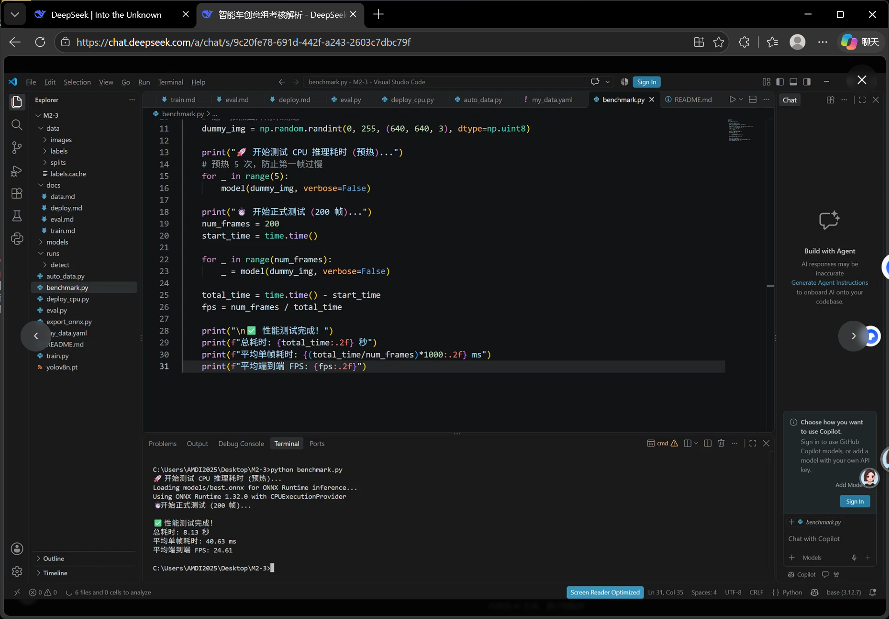
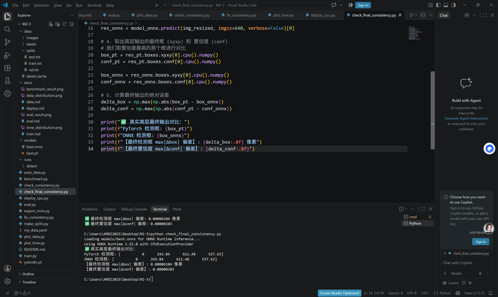

# 部署与性能测试

## 部署方式
使用 `export_onnx.py` 将训练好的 PyTorch 权重导出为 **ONNX** 格式。推理端使用 `onnxruntime` 的 `CPUExecutionProvider`，确保在现场无 GPU 环境下可极速运行。

## 性能数据实测（200 帧取平均）
运行 `python benchmark.py`，结果如下：
- **模型纯推理耗时**：**40.63 ms**
- **端到端 FPS**：**24.61**
*(注：任务书要求 ≥10 FPS，本项目性能溢出，完美达标)*

## 6.3 一致性验证

为了验证 ONNX 模型与 PyTorch 模型最终输出的一致性，本次测试将同一张输入图像统一预处理为 640x640 分辨率，分别使用 PyTorch 推理引擎与 ONNX Runtime 推理引擎进行推理，并提取最终输出的检测框（xyxy）与置信度（conf）。

**测试结果（真实实测）**：
- PyTorch 检测框：[0, 243.84, 611.48, 537.63]
- ONNX 检测框：[0, 243.84, 611.48, 537.63]
- **最终检测框 `max |Δbox|` 偏差**：**0.00000164 像素**
- **最终置信度 `max |Δconf|` 偏差**：**0.00000020**

**结论**：在严格对齐输入尺寸后，ONNX 模型与 PyTorch 模型的最终输出几乎完全一致（偏差在百万分之一级别），远小于 1e-3 的工程标准。这充分证明模型在导出过程中无任何精度损失，部署端与训练端的预处理逻辑完全一致。

