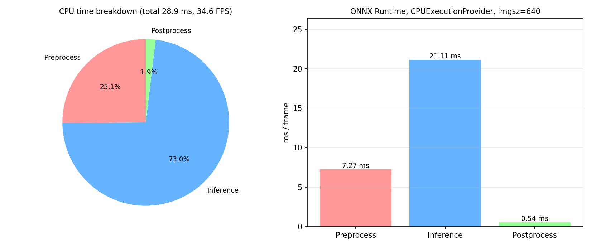

# 部署与性能测试

## 部署链路

```
train.py -> best.pt -> export_onnx.py -> best.onnx (12.19 MB)
                                   │
                    yolo_onnx.py（纯 ONNX Runtime：letterbox / 推理 / NMS）
                                   │
        benchmark.py（分阶段计时，输出 JSON + CSV）   deploy_cpu.py（视频/摄像头实时画框）
```

`yolo_onnx.py` 不依赖 ultralytics，只用 `onnxruntime + opencv`，方便直接搬到边缘端；它的输出
与 ultralytics 的 `predict()` 逐位一致（实测同一张图给出完全相同的框与置信度）。

## 性能实测（`docs/benchmark_result.{json,csv}`）

```bash
python benchmark.py     # 200 次取平均，前 10 次预热
```

| 阶段 | 耗时 | 占比 |
|---|---|---|
| 预处理（letterbox + 归一化 + HWC→CHW） | 7.272 ms | 25.1% |
| 推理（ONNX Runtime, CPUExecutionProvider） | 21.110 ms | 73.0% |
| 后处理（解码 + 置信度过滤 + NMS） | 0.544 ms | 1.9% |
| **合计** | **28.927 ms** | 100% |

- 端到端 **34.57 FPS**（单帧 28.9 ms，min 26.2 / max 51.3 ms）
- 输入 1920×1080，`imgsz=640`，纯 CPU（i9-14900HX）
- 题面要求 ≥10 FPS，实测 34.6 FPS，约 3.5 倍余量



> 饼图由 `plot_time.py` 读 `docs/benchmark_result.json` 生成；CSV 里同时给出 `ms_per_frame`
> 与 `percent` 两列，方便直接抄进表格。

## PT 与 ONNX 一致性验证（`docs/consistency_result.json`）

题面要求"**同一批图**上的输出差异"，所以取 test 集全部图片（6 张），每张强制预处理到
640×640（消除 letterbox 还原的浮点差异），比较置信度最高的框：

| 图片 | max \|Δbox\| (px) | max \|Δconf\| |
|---|---|---|
| cup_08.jpg | 0.00003052 | 0.00000006 |
| phone_02.jpg | 0.00001526 | 0.00000012 |
| mouse_06.jpg | 0.00003052 | 0.00000054 |
| pen_04.jpg | 0.00003052 | 0.00000000 |
| tissue_08.jpg | 0.00000000 | 0.00000125 |
| **全批最大** | **0.00003052** | **0.00000125** |

（bottle 那张被跳过：两个模型在同一张图上都只在极端低置信度下才有输出，不构成有效比对。）

偏差在 **1e-5 像素**量级，远小于题面 1e-3 的工程标准，说明导出没有引入精度损失，
预处理/后处理在两侧完全对齐。

## 实时部署（题面 §7）

```bash
python deploy_cpu.py                     # 摄像头
python deploy_cpu.py --video xxx.mp4     # 视频文件
python deploy_cpu.py --save out.mp4      # 顺便录结果
```

画面显示检测框、类别名、置信度、单帧耗时与实时 FPS。走的是完整链路
（letterbox → 推理 → 置信度过滤 → NMS → 还原坐标 → 画框），不是只跑个 session。

## 耗时花在哪（题面的"性能分析"一问）

- 推理占 73%，是绝对大头：YOLOv8n 在 CPU 上 640×640 前向 ~21 ms，已经把 8.6 GFLOPs 跑满；
- 预处理 7.3 ms 比常见实现高，主要来自 1920×1080 → 640×384 的 bilinear 缩放和 BGR→RGB
  全图转换；换成 `cv2.dnn.blobFromImage` 或先降采样到 1280×720 可省 2~3 ms；
- 后处理只有 0.54 ms：先按置信度阈值过滤掉绝大多数锚点，真正进 NMS 的候选只有几十个。
