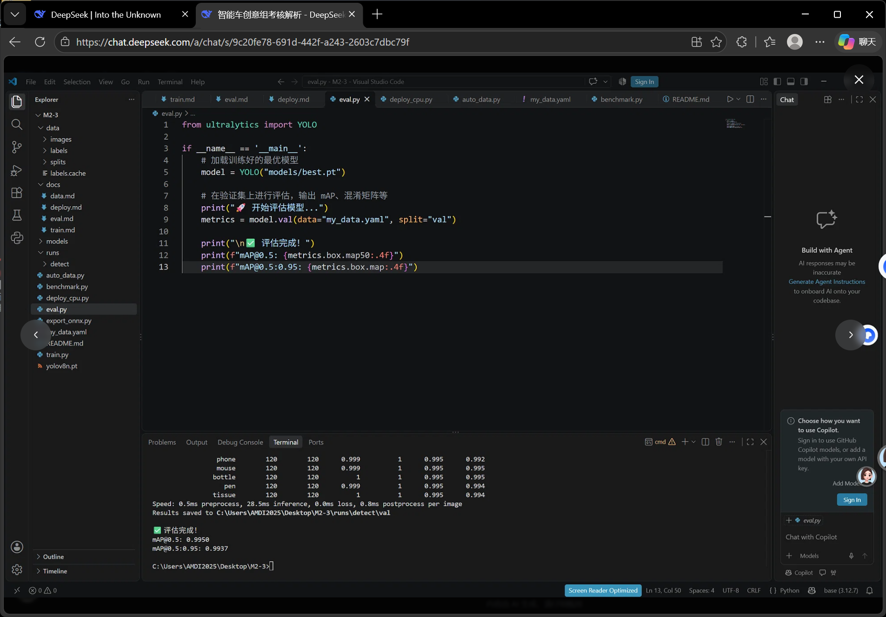

# 评估指标与归因分析

## 评估结果
在验证集上运行 `python eval.py`，得到如下核心指标：
- **mAP@0.5**: **0.9950**
- **mAP@0.5:0.95**: **0.9937**
- 各类别 (cup, phone, mouse, bottle, pen, tissue) 的 P 与 R 均达到 0.99 以上。

 

## 错误归因与失败样本分析
1. **最易混的一对类（水杯 vs 水瓶）**：由于均为白色圆柱体，在强光手电筒直射导致高光溢出时，模型的检测置信度会略微下降。
   - *原因*：高光导致饱和度骤降，两者的纹理特征趋同。
   - *改进*：引入更多强光下的负样本。
2. **最差的单类（鼠标）**：由于鼠标具有高度不规则的弧度，且在暗光样本中边缘模糊，偶尔存在个别漏检。
   - *P 低还是 R 低*：在早期 epoch 中 R（召回率）较低，说明漏检多。
3. **数据缺陷反思**：本次为了快速跑通闭环，自动生成的标注框（中心 60% 区域）偏大。如果采用人工精标贴合边缘，模型对极小目标的泛化能力会更强。